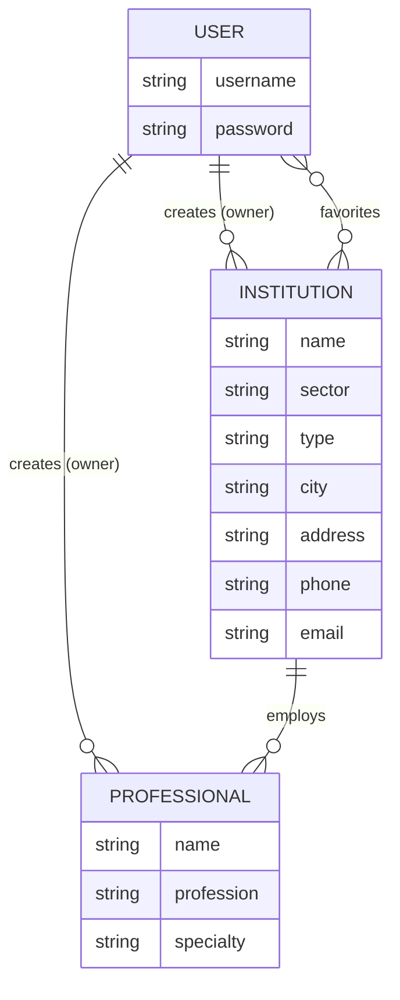

# Health Registry Montenegro


A full-stack CRUD web application that keeps public and private healthcare institutions, and the professionals who work in them, in one registry. Signed-in users add institutions and staff, manage only their own entries, and mark institutions as favorites.

## Description

Information about healthcare institutions is usually scattered across separate lists for the public and private sectors. This app brings both into a single searchable registry. Every institution has a sector (public or private), a type (health center, hospital, pharmacy, clinic, laboratory, dental clinic), contact details and a list of healthcare professionals.

Anyone can browse the registry. Signed-in users can:

- add institutions and manage the ones they created (edit and delete are owner-only),
- add, edit and delete healthcare professionals in the institutions they own,
- add institutions to their favorites and see them on their profile page.

All authorization is enforced on the server, not only by hiding buttons.

## Getting Started

**Deployed app:** DEPLOYED_LINK_HERE

**Planning materials:** the user stories and the entity relationship diagram are below.

### User stories

- As a visitor, I can browse all institutions and view the details of each one.
- As a visitor, I can sign up and sign in.
- As a signed-in user, I can add a new institution.
- As an owner, I can edit and delete the institutions I added.
- As an owner, I can add, edit and delete the healthcare professionals of my institutions.
- As a signed-in user, I can add and remove institutions from my favorites.
- As a signed-in user, I can see my favorites and my own institutions on my profile page.

### Entity relationship diagram



### Routes

| Method | Path | Access | Purpose |
| --- | --- | --- | --- |
| GET | `/` | everyone | Home page |
| GET, POST | `/auth/sign-up`, `/auth/sign-in` | everyone | Create account, sign in |
| GET | `/auth/sign-out` | everyone | Sign out |
| GET | `/institutions` | everyone | List institutions |
| GET | `/institutions/:institutionId` | everyone | Institution details and staff |
| GET, POST | `/institutions/new`, `/institutions` | signed in | Create an institution |
| GET, PUT | `/institutions/:institutionId/edit`, `/institutions/:institutionId` | owner | Edit an institution |
| DELETE | `/institutions/:institutionId` | owner | Delete an institution |
| GET, POST | `/institutions/:institutionId/professionals/new`, `/institutions/:institutionId/professionals` | owner | Add a professional |
| GET, PUT, DELETE | `/institutions/:institutionId/professionals/:professionalId` (`/edit` for the form) | owner | Edit or delete a professional |
| POST, DELETE | `/institutions/:institutionId/favorite` | signed in | Add or remove a favorite |
| GET | `/users/profile` | signed in | Favorites and own institutions |

### Run it locally

1. Clone the repository and install dependencies:

   ```bash
   git clone https://github.com/cempo2001/health-registry-montenegro.git
   cd health-registry-montenegro
   npm install
   ```

2. Create a `.env` file (see `.env.example`):

   ```
   MONGODB_URI=your MongoDB connection string
   SESSION_SECRET=a long random string
   ```

3. Optional: fill the database with fictional demo data (this deletes all existing institutions and professionals):

   ```bash
   npm run seed
   ```

   Demo accounts created by the seed: `demo_owner` and `demo_visitor`, both with the password `demo1234`.

4. Start the app and open http://localhost:3000:

   ```bash
   npm run dev
   ```

## Attributions

- The structure of the app follows the OpenHouse MEN-stack lessons from General Assembly.
- Font: [Montserrat](https://fonts.google.com/specimen/Montserrat) via Google Fonts.
- All institutions, people, phone numbers and emails in the demo data are fictional.
- Development was done with guidance from Claude (Anthropic), used as a coding assistant.

## Technologies Used

- Node.js and Express 5
- MongoDB Atlas and Mongoose
- EJS templates
- express-session with connect-mongo (session storage in MongoDB)
- bcrypt (password hashing)
- method-override (PUT and DELETE from HTML forms)
- morgan (request logging), dotenv, nodemon
- HTML and CSS (Flexbox and Grid)

## Next Steps

- Run Mongoose validators on updates (`runValidators`), because `updateOne` currently skips them.
- Restrict sector, type and profession to allowed values in the schema (they are limited only by the form today).
- Return only the owner's username when populating, so the password hash never leaves the database layer.
- Add flash messages and a confirmation step before deleting.
- Add search, filters by sector, type and city, and pagination.
- Let several users manage the staff of the same institution and add an admin role.
